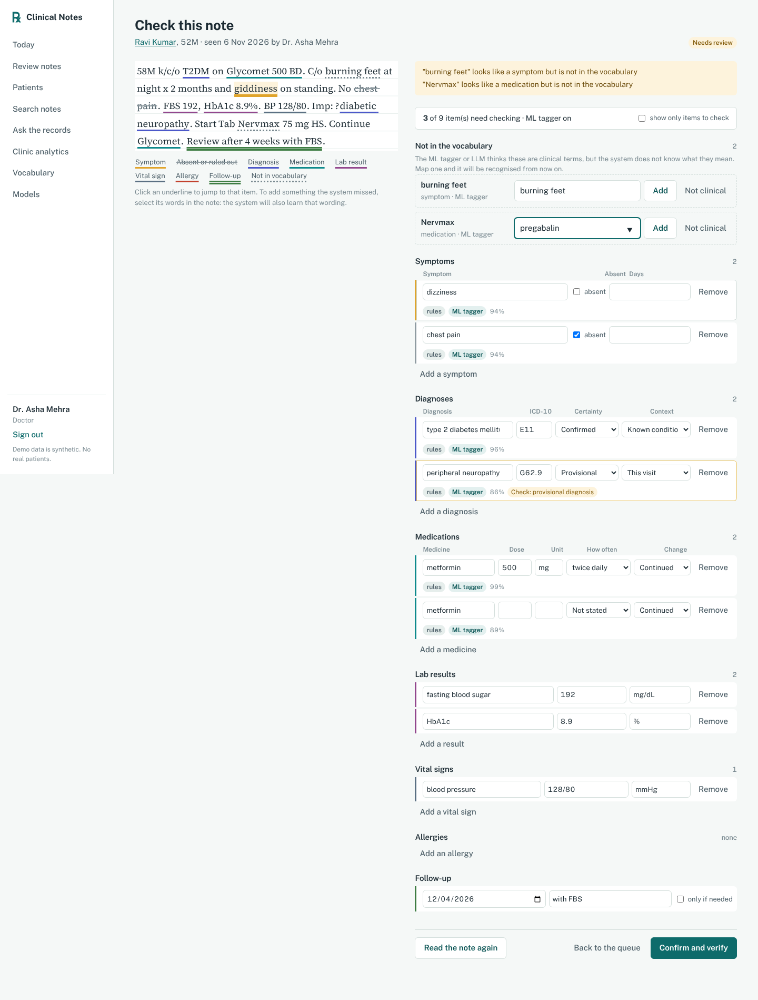

# Clinical Notes Intelligence System

Doctors write consultation notes the way they always do. Three **local** extractors read each note: clinical rules with an Indian drug lexicon, a **machine-learned sequence tagger** trained on the clinic's own verified notes, and optionally a **local LLM through Ollama**. Their agreement sets each item's confidence; confident items are auto-accepted and the rest are flagged for the doctor, who confirms the note. Words the system did not know are learned from the doctor's corrections. Verified notes then power semantic search, a question-answering assistant, follow-up tracking, clinic analytics and **FHIR R4 export**, all on **MongoDB**.

No cloud AI API is used. The rules and ML models run inside the Node.js server, the LLM runs in Ollama on the same machine, and all patient data is **synthetic**.



## What it does

| Screen | What happens |
| --- | --- |
| **Write a note** | Free-text entry with a live preview that underlines everything the extractor recognises while you type. |
| **Review notes** | Each new note is processed through a change stream. The doctor sees the note with colour-coded underlines beside editable fields. Every item shows which models found it (rules, ML tagger, LLM) and its confidence; uncertain items are flagged with the reason, and "show only items to check" hides the rest. Clinical words no lexicon knows (an unfamiliar brand, a new symptom phrase) are listed under *Not in the vocabulary* to map in one click, and the doctor can select any text in the note to add it. Review time is recorded. Verified notes download as a FHIR R4 bundle. |
| **Today** | The review queue and missed follow-ups, updated live over WebSockets. Front-desk staff can reveal a phone number (audited) and log reminder calls. |
| **Patients** | An extractive summary built from verified notes: current medicines, latest results with the previous value, open follow-ups and a visit timeline. |
| **Search notes** | Hybrid search: local sentence embeddings plus MongoDB `$text`, fused by reciprocal rank. It is negation-aware, so "No SOB" does not match "breathlessness". |
| **Ask the records** | Plain-English questions are turned into validated, read-only MongoDB aggregation pipelines. Every answer can show its exact query. |
| **Clinic analytics** | Visits, follow-up compliance, top diagnoses and medicines, live extraction accuracy measured from doctors' corrections, review time, and how often auto-accepted items are kept. |
| **Vocabulary** | Brand names and wordings the clinic has taught the system, who taught them, and a switch to turn each off. |
| **Models** | Status of the rules, the ML tagger (with its held-out score and a retrain button) and Ollama. |
| **Access log** | Every view, search, reveal and verification, stored in a time-series collection. |

More screenshots: [select text to add](docs/screenshots/11-add-selected.png) · [learned on verify](docs/screenshots/12-learned.png) · [vocabulary](docs/screenshots/13-vocabulary.png) · [models](docs/screenshots/14-models.png) · [declining an unanswerable question](docs/screenshots/15-abstain.png) · [review (rules only, earlier version)](docs/screenshots/03-review.png) · [today](docs/screenshots/02-today.png) · [write a note](docs/screenshots/04-new-note.png) · [assistant](docs/screenshots/05-assistant.png) · [search](docs/screenshots/06-search.png) · [analytics](docs/screenshots/07-analytics.png) · [patient](docs/screenshots/08-patient.png) · [mobile](docs/screenshots/09-mobile.png)

## Quick start

Requirements: Node.js 20 or newer, and MongoDB running as a **replica set**. Transactions and change streams need a replica set. Atlas clusters are replica sets by default.

**Option A: MongoDB Atlas (free M0 cluster).** Create a cluster, add a database user, allow your IP, and copy the connection string.

**Option B: local MongoDB.**

```bash
mongod --replSet rs0 --dbpath ./data --port 27017
mongosh --eval 'rs.initiate({_id:"rs0",members:[{_id:0,host:"127.0.0.1:27017"}]})'   # once
```

Then:

```bash
npm run setup                          # installs server and client packages
cp server/.env.example server/.env     # set MONGODB_URI, JWT_SECRET, FIELD_ENC_KEY
npm run seed                           # 500 synthetic patients, ~1,700 notes, follow-ups, search index, trains the ML tagger
npm run server                         # API on http://localhost:4000
npm run client                         # app on http://localhost:5173 (second terminal)
```

Sign in with **doctor@clinic.test**, **staff@clinic.test** or **admin@clinic.test**. The password for all three is `demo1234`.

For a single-process deployment, run `npm run build` and then `npm start`. The API then serves the built app on port 4000.

**Optional: the local LLM.** Install [Ollama](https://ollama.com), then:

```bash
ollama pull qwen2.5:7b          # about 4.7 GB; any instruction model works, set OLLAMA_MODEL
ollama pull nomic-embed-text    # only if you set EMBEDDING_MODE=ollama
```

The server checks Ollama every 30 seconds and uses it when the model is present (`LLM_EXTRACTION` and `LLM_ASSISTANT` = `auto`). Without it everything still works with rules + ML. A 7B model on a laptop CPU takes several seconds per note, which is fine because extraction runs in the background queue. For testing without Ollama, `npm run mock-ollama` starts a heuristic stand-in that speaks the same API (it is for checking the plumbing only and says nothing about real model quality).

| Command | What it does |
| --- | --- |
| `npm test` | 26 unit tests: extractor, negation, spans, embeddings, time parsing, assistant routing and abstention, validator, ML tagger, LLM grounding, ensemble merging, learned vocabulary, triage, FHIR |
| `npm run evaluate` | Full offline evaluation; writes `server/EVALUATION.md` and `server/EVALUATION-ENSEMBLE.md` (add `--llm` to `npm --prefix server run evaluate:ensemble -- --llm` to include Ollama) |
| `npm --prefix server run agreement -- a.json b.json` | Inter-annotator agreement for a real-world blind set (see [docs/ANNOTATION_GUIDE.md](docs/ANNOTATION_GUIDE.md)) |
| `npm --prefix server run reindex` | Re-embed all notes after switching embedding model (also happens automatically at startup) |
| `npm --prefix server run indexes` | Create the Atlas Vector Search index (Atlas only; then set `ATLAS_VECTOR_SEARCH=true`) |

## Architecture

```
 React (Vite)  ──REST + Socket.IO──►  Node.js / Express API  ──────────►  MongoDB (replica set)
                                       │                                   ├─ patients        ($jsonSchema, encrypted phone)
                                       ├─ nlp/extractor     (rules + merge)├─ encounters      (note + extraction + corrections + review)
                                       ├─ nlp/ml/tagger     (perceptron)   ├─ note_chunks     (embeddings, $text index)
                                       ├─ nlp/llm ─────────► Ollama        ├─ followups       (lifecycle, daily overdue job)
                                       ├─ nlp/embedder      (local vectors)├─ vocabulary      (terms learned from doctors)
                                       ├─ nlp/assistant     (classifier,   ├─ audit_logs      (time-series)
                                       │    slots, query builder,          ├─ assistant_logs  (questions, queries, ratings)
                                       │    validator)                     └─ eval_ground_truth (synthetic labels)
                                       ├─ services/fhir     (FHIR R4 export)
                                       └─ change streams ◄── watches encounters
```

The life of a note:

1. A doctor saves a note, which is stored with status `pending`.
2. A change stream picks it up. The rules, the ML tagger and (if available) the LLM run; their mentions are merged, scored and triaged, and the status becomes `needs_review`.
3. The doctor edits and verifies it. One **multi-document transaction** marks the note verified, stores the correction statistics and triage outcome, closes the patient's earlier open follow-ups, creates the new follow-up, and writes the note's search vectors.
4. Wordings the doctor mapped are saved to `vocabulary` and used by the rules at once. Every 50 verified notes the ML tagger retrains in the background.
5. Only verified notes are used by search, the assistant and analytics.

## The local models

### 1. Clinical information extraction: an ensemble of three local extractors

**a. Rules and lexicons** (`server/src/nlp/extractor.js`): transparent, needs no training data or GPU, and every output points to the exact text it came from:

- **Dictionary NER** over curated lexicons: 72 drugs with Indian brand names (Glycomet → metformin, Telma → telmisartan, Dolo → paracetamol), 41 diagnoses mapped to **ICD-10**, 45 symptoms with lay and clinical synonyms, and 22 lab tests with reference ranges. Longest match wins, and short ambiguous abbreviations ("DM", "AGE", "Pan") need context to count.
- **Typo tolerance:** Jaro-Winkler matching ("Metformn", "vomitting") with lower confidence and a review warning.
- **NegEx-style negation** scoped to clauses ("No fever, cough or vomiting but c/o headache"). **Uncertainty** ("?Dengue", "likely", "r/o") becomes *provisional*; "ruled out" becomes *ruled_out*. **Context** separates *known* conditions (k/c/o), *past history* and *family history*.
- **Medication attributes:** dose and unit (including implicit units like "Telma 40"), frequency (OD/BD/TDS/HS/SOS/1-0-1), course length (x 5 days, 3/7, 2/52), and the action (start, continue, increase, reduce, stop, prescribe). "Rash after starting Augmentin" counts as history, not a new prescription.
- **Vitals, labs and allergies**, with high/low flags.
- **Follow-up** dates from "review in 4 wks", "f/u 1/52", "review on 15/10/2026" and "review SOS", plus the purpose ("with HbA1c").
- Every item stores its **character span**. That drives the underlines and lets the system check that nothing was invented.

**b. ML sequence tagger** (`server/src/nlp/ml/tagger.js`): a linear-chain **averaged structured perceptron** with Viterbi decoding over BIO tags (symptom, diagnosis, drug), written from scratch. Features are the word, its lower-case form and shape, prefixes and suffixes, neighbouring words, cues such as "Tab"/"c/o"/"Dx:", and the lexicon's own tag for the token. During training the lexicon feature is randomly dropped (50%), which forces the model to learn from context, so it can recognise a brand name it has never seen ("Tab Nervmax 75 mg HS"). It trains in seconds on the verified notes, gold spans coming from the doctor-confirmed items, and is saved to `models/ner-model.json`.

**c. Local LLM through Ollama** (`server/src/nlp/llm/`): `qwen2.5:7b` by default, called with a JSON schema in Ollama's `format` field so it can only return `{mentions: [{type, text}]}`. The LLM is asked to copy words from the note, never to normalise or code them. Each mention must then be found **word-for-word in the note** or it is discarded and logged (`meta.models.llm.discardedNotInNote`), so the LLM cannot add a symptom that was not written.

**Merging and confidence.** Mentions from the tagger and LLM that overlap a rule finding add their name to its `sources` and raise its confidence (agreement of two or three extractors). New mentions are normalised through the lexicon (exact, then fuzzy); those that map become items with a lower base confidence, and those that do not are returned as **unmapped** for the doctor. All attributes (negation, dose, frequency, follow-up) still come from the rules, which are the most reliable part.

**Triage.** An item is flagged *check* if its confidence is below 0.85 or for a specific reason: possible typo, provisional diagnosis, no dose on a new prescription, unclear whether a drug was taken, started or stopped, found by only one learned model, or an allergy (always confirmed). The rest are auto-accepted. On verification the system records how many auto-accepted items the doctor changed, so the safety of triage is measured continuously.

**Learning from corrections** (`server/src/services/vocabulary.js`). When a doctor maps an unmapped word or selects text and adds it, the item is sent with `learn: true` and its span. On verify, the written form is saved to the `vocabulary` collection as an alias of the concept and loaded into the rules immediately, so the next note with that brand is recognised by the rules (with full dose and frequency parsing).

### 2. Sentence embeddings for semantic search (`server/src/nlp/embedder.js`)

- **all-MiniLM-L6-v2** (384 dimensions) runs locally through ONNX (`@huggingface/transformers`). It is downloaded once (about 23 MB) and then works offline.
- **clinhash-384** is a fallback that needs no download. It expands brand names and abbreviations through the lexicons, adds clinical paraphrases (climbing stairs → exertion) and drug-class concepts (amlodipine → blood pressure medicine), handles negation scope, and hashes word, bigram and character 4-gram features into 384 dimensions.
- Optionally, `EMBEDDING_MODE=ollama` uses an Ollama embedding model (`nomic-embed-text`) instead; run `npm --prefix server run reindex` after switching.
- Each vector records the model that produced it. Search never mixes models, and the server re-indexes automatically when the model changes.
- On Atlas, search uses **`$vectorSearch`** with pre-filters (patient, date, diagnosis). Locally it does an exact cosine scan. Either way the results are fused with `$text` keyword hits by reciprocal rank fusion.

### 3. The clinic assistant (`server/src/nlp/assistant/`)

1. **Slot filling** finds drugs and drug classes, diagnoses, symptoms, lab thresholds ("HbA1c above 8"), time ranges ("this month", "last 30 days", "in September"), patient names (fuzzy), limits, and count-versus-list wording.
2. **Intent classifier:** TF-IDF features (stemmed uni- and bigrams over slot-masked text) feeding a **multinomial logistic regression**, written from scratch in JavaScript and trained on 237 example questions across 14 intents at startup (under 1 second).
3. **Safety rules** override the classifier for data-changing requests and for clinical advice ("what dose should I give"), which are declined. Questions about things notes never record (blood group, ward, billing, insurance, pharmacy stock) get an **"I can't answer that from the notes"** reply instead of a guess; the classifier also has an `unanswerable` class.
4. **LLM fallback for unclear questions.** When the classifier is unsure, the question goes to the local LLM, which fills a fixed JSON form (intent, drugs, diagnoses, lab test, comparator, value, time phrase, patient). Every field is re-validated against the lexicons, the time parser and the patient list; unknown terms are dropped and reported. The LLM never writes a database query: the same query builder and validator below are used.
5. **Query builder:** each intent becomes a MongoDB **aggregation pipeline** (with `$lookup`, `$unwind`, `$group`, `$dateTrunc` and similar).
6. **Validator:** an allowlist of stages and collections. It blocks `$out`, `$merge`, `$where`, `$function`, nested lookups, reads of `phoneEnc` or `passwordHash`, and unverified data. It adds a result cap, then runs the query read-only with `maxTimeMS`.
7. Answers are fixed templates filled from query results, so the assistant cannot invent a number or a name. Narrative questions go to semantic search, and patient summaries are extractive. For search results the LLM may add a **short summary citing the numbered notes**; it is shown only if every sentence cites a note that was given and every number in it appears in the cited notes.

### 4. Interoperability: FHIR R4 export (`server/src/services/fhir.js`)

`GET /api/encounters/:id/fhir` and `GET /api/patients/:id/fhir` return a FHIR R4 `collection` Bundle: Patient, Encounter, Condition (ICD-10 **and SNOMED CT** codes, with verification status from certainty), Observation for symptoms (present/absent), labs (**LOINC**, UCUM units, high/low interpretation) and vitals (blood pressure as a panel with components), MedicationStatement, AllergyIntolerance, Appointment for the follow-up, and optionally the note as a DocumentReference. This is the shape India's ABDM health information exchange uses. Mapping brands through the SNOMED CT India Drug Extension is listed under limitations.

## MongoDB features used

| Feature | Where | Why |
| --- | --- | --- |
| Flexible documents | `encounters.extraction` | Notes differ in which fields they contain |
| `$jsonSchema` validators | encounters, followups, patients, users | The database rejects malformed NLP output |
| Compound and multikey indexes | medication generic name, ICD-10 code, follow-up status and date | "Patients on X", "overdue this week" |
| Aggregation pipelines | analytics, every assistant answer | Grouping, lookups, date bucketing |
| Multi-document transactions | verifying a note | Note, follow-ups and search vectors change together |
| Change streams | extraction queue, live dashboard | New notes are processed at once; screens update live |
| Unique compound index + upsert | `vocabulary` (type, alias) | A learned wording is stored once however many doctors teach it |
| Time-series collection (with TTL) | `audit_logs` | Efficient access logging, kept for 2 years |
| `$text` index + Atlas `$vectorSearch` | `note_chunks` | Hybrid search |
| Scheduled job | daily overdue check (node-cron; an Atlas Scheduled Trigger in production) | Follow-ups become overdue after a grace period |
| Role-based access + optional read-only user | API roles; `READONLY_MONGODB_URI` | Staff can't read notes; doctors can't reveal phones; the assistant can only read |

## Evaluation

`npm run evaluate` scores every model against ground truth. Full results are in [`server/EVALUATION.md`](server/EVALUATION.md).

| Test | Result |
| --- | --- |
| Extraction on **blind** hand-written notes (never used for tuning) | Symptoms F1 97.3%, diagnoses F1 96.0% (88.0% including certainty), medicines F1 100%, labs 100%, dose 95%, follow-up date 91.7% |
| Extraction on 400 held-out generated notes | F1 99–100% (optimistic: the generator shares the extractor's vocabulary) |
| Assistant intent on 70 held-out questions | 70/70 correct; 75.7% in 5-fold cross-validation on the training questions (lower than before because a 15th intent, *unanswerable*, was added) |
| Semantic search, paraphrased queries | 69.3% precision vs 39.8% for keyword matching |
| Query safety | 14/14 adversarial pipelines blocked |

The blind set is the honest number. The edge-case set was used during development to find bugs, so its perfect score is optimistic.

The changes over prior work are evaluated separately in [`server/EVALUATION-ENSEMBLE.md`](server/EVALUATION-ENSEMBLE.md):

| Test | Result |
| --- | --- |
| Brand names removed from the lexicon (53 of 160), 85 mentions in unseen notes | Rules find 9.4%; with the ML tagger 91.8% are found (mapped or offered to the doctor to map) |
| Learning from corrections, 8 batches of 50 notes | Medication recall recovers from 92.6% to 99–100% as 20 brands are learned; with the ML tagger 18 of the 20 were already highlighted, so the doctor picked from a list instead of hunting through the text |
| Review triage, 400 unseen generated notes | 97.7% of items auto-accepted, 100% of those kept by the (simulated) doctor; all 12 extractor errors were flagged |
| Review triage, 32 hand-written notes | 91.3% auto-accepted, 98.7% kept; 2 of 4 extractor errors flagged |
| Rules vs rules + ML on the blind set | Same F1; the tagger adds about one "not in vocabulary" suggestion per note, mostly real terms the lexicon lacks (e.g. "burning feet", "crying spells") |
| Abstention | 10/10 unanswerable questions declined, 0 of 53 answerable ones wrongly declined (optimistic: the rule list was written while looking at these questions) |
| Local LLM | **Not measured here**: Ollama cannot run in the environment this was built in. All LLM paths were tested end to end against the mock server; run `evaluate:ensemble -- --llm` with Ollama to fill in the column |

## Privacy: why synthetic data

Real clinical notes would require patient consent, ethics approval and the safeguards of India's Digital Personal Data Protection Act, 2023 and its 2025 Rules. A student project cannot responsibly provide those. Instead, `server/scripts/synth/generator.js` simulates fictional patients: chronic conditions with medication regimens that change with their lab results, acute illnesses, adverse drug reactions, and patients who miss follow-ups. It writes each note in realistic shorthand, with brand names, abbreviations and the occasional typo, and records the true facts behind every note as labels.

The system is still built as if the data were real:

- Phone numbers are encrypted at the field level (AES-256-GCM).
- Every access is audited.
- Roles limit who sees notes and contact details.
- Only note text, without the name, phone or ID, goes to the extractor.
- No data leaves the server, because there are no external APIs.

## What is new compared with prior work

The literature survey found that clinical NLP systems are mostly either rule-based (cTAKES, MedCAT-style dictionaries) or LLM-based, are evaluated once on a fixed corpus, and rarely measure the doctor's review effort. This version adds:

1. **Learning vocabulary from corrections:** every mapping a doctor makes becomes part of the lexicon at once, with provenance, and the learning curve is measured (section C of the ensemble evaluation).
2. **A local ML model trained on the clinic's own verified notes**, compared against rules alone and combined with them, including a test on brand names the lexicon has never seen.
3. **Confidence-based review triage** from extractor agreement, with its safety measured on every verification and review time recorded.
4. **Standard codes and FHIR export:** SNOMED CT alongside ICD-10, LOINC for labs and vitals, FHIR R4 bundles in the shape ABDM uses.
5. **Abstention:** the assistant says when the notes cannot answer, and the LLM's outputs are only used when grounded in the note or the validated query path.
6. **Tooling for a real-world blind set:** an annotation guide and an inter-annotator agreement script (span F1, Cohen's kappa), so the next step, real de-identified notes, can be measured properly.

## Changes from the project report

- **No cloud LLM API.** Extraction, embeddings and the assistant use local models; the LLM is Ollama on the same machine and is optional. This removes cost, keeps data on the server, and keeps outputs explainable.
- **Simplified MERN stack:** one Node.js server instead of a separate Python AI service.
- **A built-in synthetic generator instead of Synthea:** notes and labels are produced together, which makes evaluation exact.

## Known limitations

- The lexicons cover common outpatient conditions and drugs only. Anything outside them is missed, though the doctor can add it at review.
- On the blind set the extractor missed "AOM" written without a "Dx:" cue, "48 hrs" as a follow-up interval, "1 tab" read as a dose, a temperature written as "fever 101F", and "CKD stage 3?" as provisional.
- Search ranks by meaning, but a query that shares many routine words with ordinary notes (for example "swelling of feet after a blood pressure tablet") can still rank routine "Denies swelling of feet" notes above the few real matches. IDF weighting was tried and lowered the overall score, so it was not kept.
- Scores on synthetic notes will be higher than on real notes. A real deployment would need a pilot with consent and ethics approval.
- Run one API instance. With several, each would watch the change stream and process new notes more than once.
- **The LLM's quality is unmeasured.** It could not be run where this was built; the mock server only proves the plumbing. A 7B model may miss mentions or mislabel types; grounding stops invented text but not a wrong type, which is why LLM-only items are always flagged.
- **The ML tagger's held-out F1 (~100%) is not meaningful by itself:** it is trained and tested on generated notes from the same templates. The reduced-lexicon test in the ensemble evaluation is the useful measure of what it adds.
- Learned symptom phrases become new concepts (for example "giddiness on standing") rather than being linked to an existing one; a doctor can turn them off on the Vocabulary page. Brand names are not yet mapped through the SNOMED CT India Drug Extension, which would give codes for the 90,000+ Indian branded medicines.
- Review times in the seeded data are simulated; only notes verified through the app have real times.

## Project structure

```
server/
  src/nlp/extractor.js        clinical NER, negation, attributes, follow-up, ensemble merge, triage
  src/nlp/ml/                 sequence tagger (averaged perceptron) and its training service
  src/nlp/llm/                Ollama client, grounded LLM extraction, assistant parsing and cited summaries
  src/nlp/lexicon/            drugs (brands), diagnoses (ICD-10 + SNOMED), symptoms, labs (LOINC)
  src/nlp/embedder.js         MiniLM (ONNX) + clinhash-384 embeddings
  src/nlp/assistant/          intents, classifier, slots, query builder, validator
  src/services/               encounters (transaction), extraction, vocabulary, FHIR, search, follow-ups, change streams, crypto
  src/routes/                 REST API and analytics
  scripts/seed.js             synthetic database
  scripts/evaluate.js         offline evaluation → EVALUATION.md
  scripts/evaluateEnsemble.js rules vs ML vs LLM, unseen brands, learning curve, triage, abstention → EVALUATION-ENSEMBLE.md
  scripts/agreement.js        inter-annotator agreement (span F1, Cohen's kappa)
  scripts/mockOllama.js       stand-in for Ollama for tests
  scripts/data/               edge cases, blind test notes, assistant test questions
  tests/                      unit tests (node:test)
client/
  src/pages/                  Today, Review, Write a note, Patients, Search, Assistant, Analytics, Vocabulary, Models, Access log
  src/components/ui.jsx       highlighted note, charts, tables
docs/ANNOTATION_GUIDE.md      how to build and measure a real-world blind set
docs/screenshots/
```
